# Agora

A full-stack social "public square": a feed, posts with polls and media, comments, profiles, explore, notifications, direct messages with voice notes and attachments, and settings. It runs on a real API, a Postgres database and real authentication.

It also has a **Demo mode** that runs every screen against a simulated backend in your browser. You can try it without an account and switch the network to Slow, Offline or Flaky to see how the app handles it.

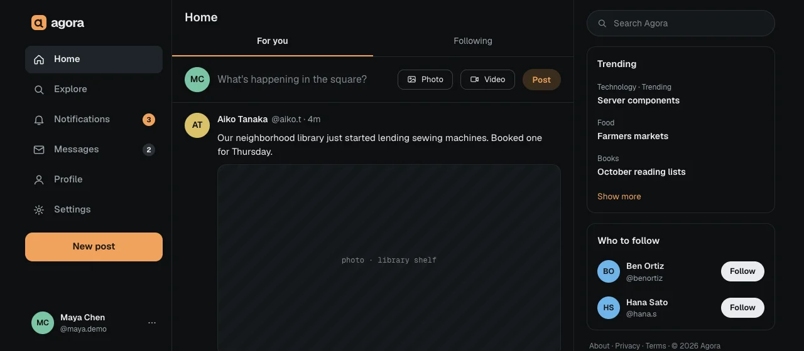

## Screenshots

<table>
  <tr>
    <td width="50%">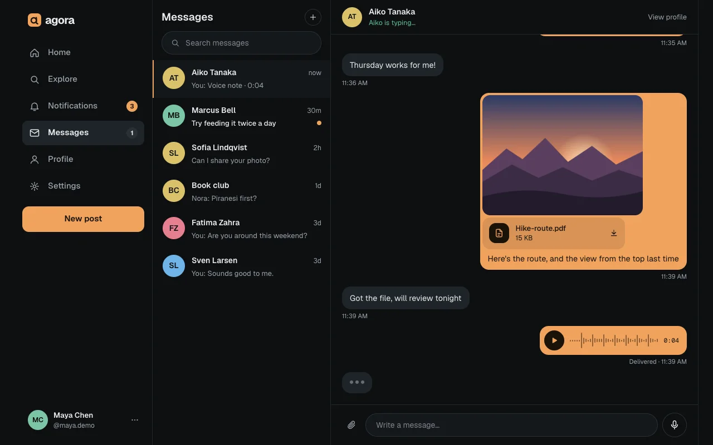<br><sub><b>Messages:</b> photos, documents, voice notes and live typing status</sub></td>
    <td width="50%">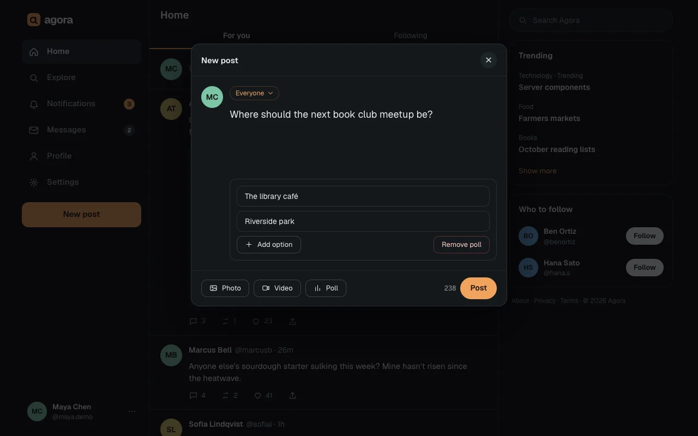<br><sub><b>Compose:</b> audience, poll, photo or video, character counter</sub></td>
  </tr>
  <tr>
    <td>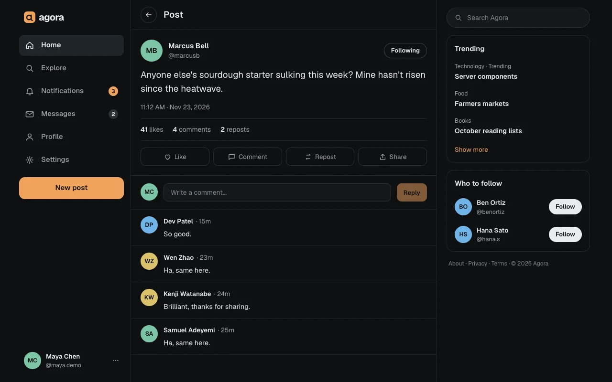<br><sub><b>Post:</b> stats, actions, reply box and comments</sub></td>
    <td>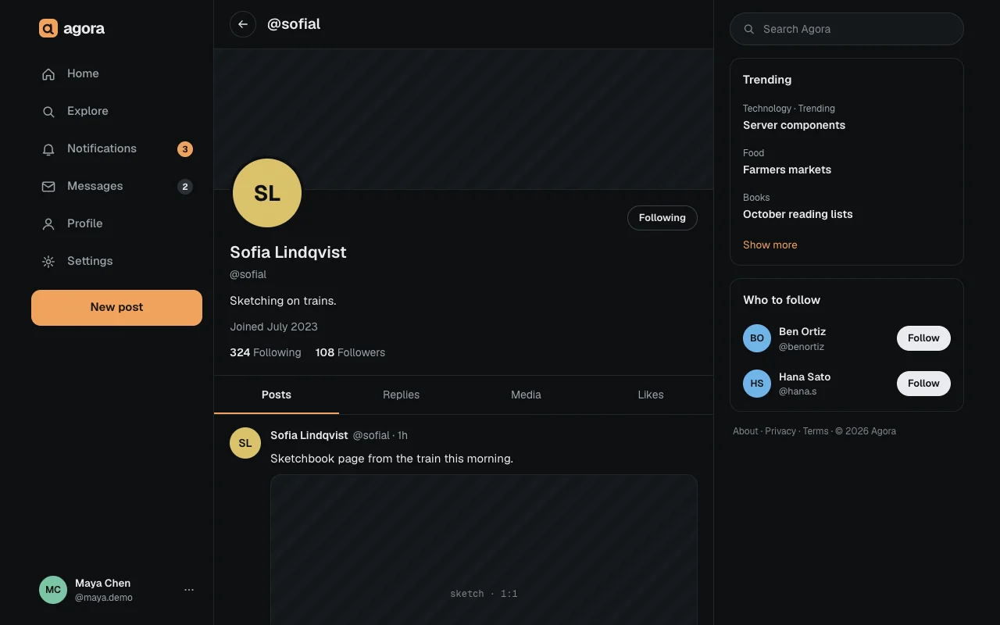<br><sub><b>Profile:</b> cover, bio, follow, and Posts / Replies / Media / Likes</sub></td>
  </tr>
  <tr>
    <td>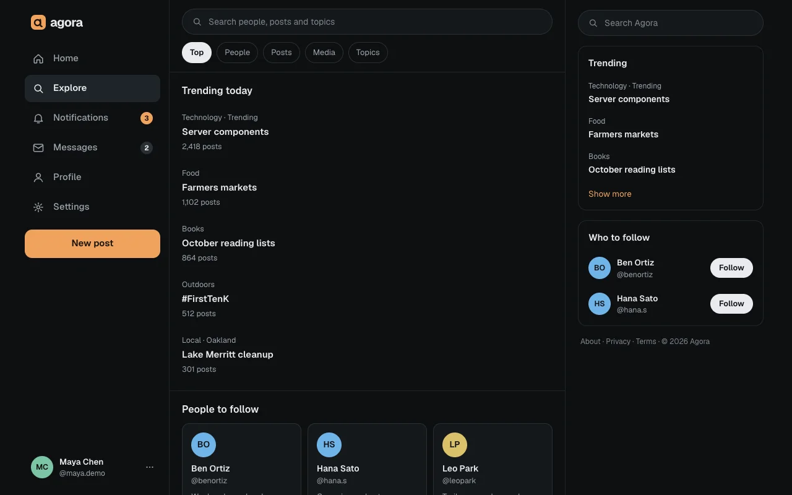<br><sub><b>Explore:</b> search, Trending today and people to follow</sub></td>
    <td>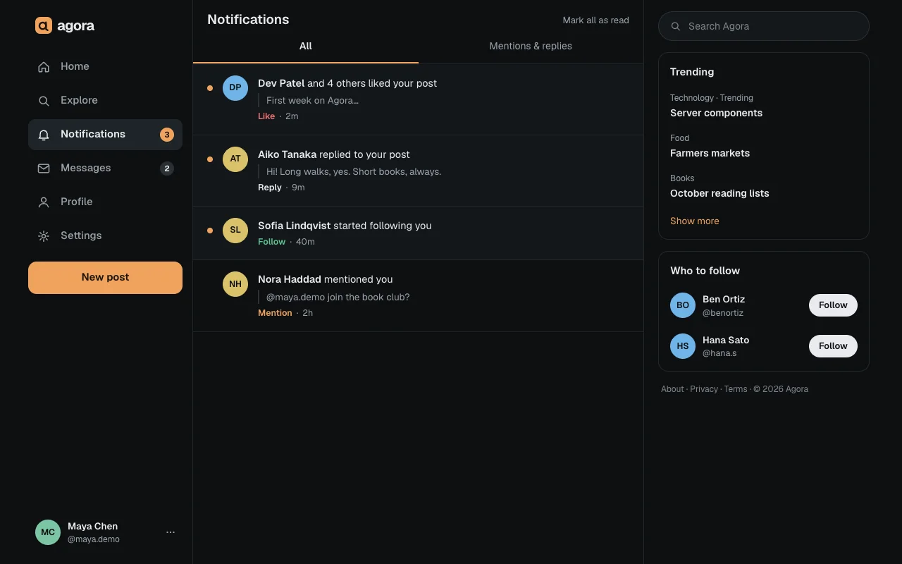<br><sub><b>Notifications:</b> likes, replies, follows and mentions</sub></td>
  </tr>
  <tr>
    <td>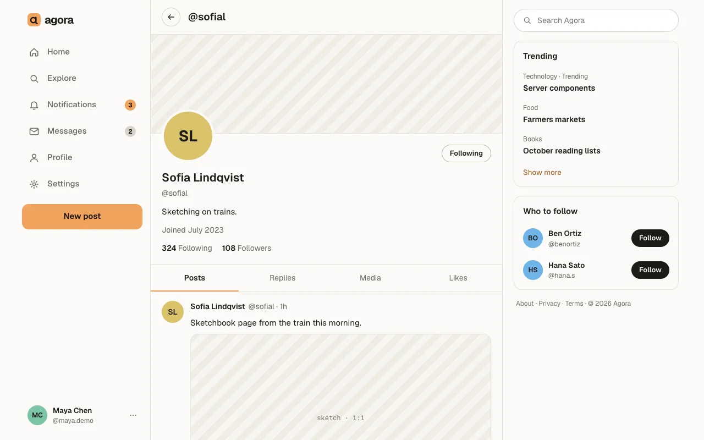<br><sub><b>Light theme:</b> Dark, Light or System</sub></td>
    <td>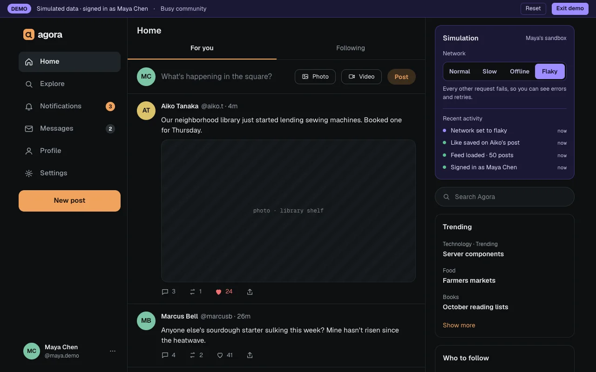<br><sub><b>Demo mode:</b> simulated backend, network conditions and an activity log</sub></td>
  </tr>
</table>

<table>
  <tr>
    <td width="50%" align="center">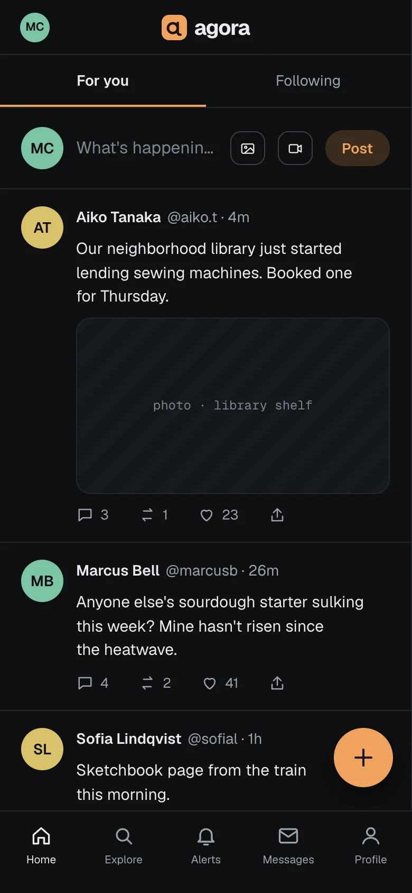<br><sub><b>Phone:</b> home feed</sub></td>
    <td width="50%" align="center">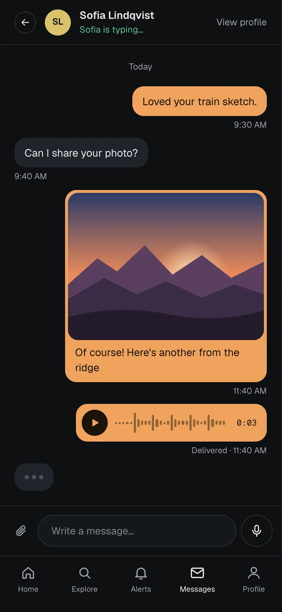<br><sub><b>Phone:</b> messages</sub></td>
  </tr>
</table>

## Features

- **Feed:** For you and Following tabs. Likes and reposts update straight away (optimistic) and roll back if the request fails. Share copies the post link. The feed has loading, empty and error states, and "You're all caught up" at the end.
- **Posts:**
  - Compose with an audience (Everyone or Followers), polls of 2–4 options, a photo or video, and a character counter.
  - Edit or delete your own posts and comments.
  - Media keeps its original shape and opens full size.
- **Profiles:** cover and avatar uploads, a bio, follow and unfollow, and Posts, Replies, Media and Likes tabs.
- **Explore:** search people, posts, media and topics, plus Trending today and suggested people.
- **Notifications:** likes, replies, mentions and follows, with Mark all as read.
- **Messages:**
  - Up to 4 photos, videos or documents per message.
  - Voice notes with a live level meter, a waveform player and seeking.
  - Live updates and "Lena is typing…".
- **Settings:** account details, the default audience for new posts, notification switches, and a Dark, Light or System theme.
- **Accessibility:**
  - Keyboard navigation, skip-to-content and visible focus states.
  - Toasts in a live region.
  - WCAG AA contrast in both themes.
  - Tap targets of at least 44 × 44 px.
  - Animations respect reduced-motion settings.
- **Mobile:** a single column with a bottom tab bar, a floating compose button and a full-screen compose sheet.

## Tech stack

- **Next.js 16** (App Router), **React 19** and **TypeScript**
- **Tailwind CSS v4**, with design tokens for the dark and light themes
- **Postgres (Neon)** through `pg`, with hand-written SQL and no ORM
- **Better Auth** for email and password sign-in, Google sign-in, sessions stored in Postgres, and rate limiting
- **Vercel Blob** for media, using a small hand-written upload client
- Hosted on **Vercel**

The only runtime dependencies are Next.js, React, `pg` and Better Auth. Everything else is built in the repo: the components, icon set, toasts, modals, menus, data cache, upload client, voice recorder and the simulated backend.

## How it's built

- **One data contract, two backends.** Components only talk to a `DataSource` type (`types/dataSource.ts`).
  - The app uses the API client (`services/api/`).
  - The demo uses a simulated server in the browser (`services/simulated/`) with seeded data, realistic latency, network conditions and an activity log.
  - The same pages serve both, and `/demo/*` mirrors every app route.
- **SQL returns what the UI needs.** SQL functions such as `post_view` and `conversation_view` build the exact JSON of each view type (`db/migrations/0003_views.sql`).
  - Repositories select one `view` column per row.
  - Visibility rules, such as "Followers only" posts, live in SQL (`can_see_post`).
- **Optimistic writes.** Read hooks wrap a small query cache (loading, empty, error, success). Write hooks patch the cache straight away, roll back on failure and offer Retry.
- **Direct uploads.** The API checks the file type and size, then signs a short-lived token for a single path in the user's folder. The browser uploads straight to Blob and shows progress. The API only saves URLs from that user's folder.
- **Live chat over polling.** An open conversation checks for new messages and typing status every 2 seconds while the tab is visible.

## Project structure

| Folder | Holds |
|---|---|
| `app/` | Routes, layouts, API route handlers, design tokens (`globals.css`) |
| `components/` | All UI components, grouped by feature |
| `context/` | React context providers |
| `hooks/` | Custom hooks, grouped by feature |
| `lib/` | Feature constants, the database pool, auth config, the query cache |
| `services/` | API client, simulated backend, database repositories, Blob and auth calls |
| `types/` | Shared types |
| `utils/` | Pure helpers |
| `db/migrations/` | SQL migrations, applied in file-name order |
| `scripts/` | The migration and seed scripts |

## Getting started

You need Node.js 22.18 or later, a Postgres database (a free [Neon](https://neon.tech) project works), and optionally a Google OAuth client and a Vercel Blob store.

```bash
npm install
cp .env.example .env.local   # then fill in the values
npm run db:migrate           # create the tables
npm run db:seed              # load the starter community
npm run dev
```

Then open [http://localhost:3000](http://localhost:3000). The seed creates a sample account, `sam@example.com` with the password `agora-2026`, and the sign-in form starts filled in with it. The demo at `/demo` needs no account.

### Environment variables

| Name | What it is |
|---|---|
| `DATABASE_URL` | Postgres connection string |
| `BETTER_AUTH_SECRET` | Random secret, for example from `openssl rand -base64 32` |
| `BETTER_AUTH_URL` | Where the app runs, such as `http://localhost:3000` or your production URL |
| `GOOGLE_CLIENT_ID`, `GOOGLE_CLIENT_SECRET` | Google OAuth client. The redirect URI is `<BETTER_AUTH_URL>/api/auth/callback/google` |
| `BLOB_READ_WRITE_TOKEN` | Read-write token of a Vercel Blob store with public access |

### Scripts

| Command | Does |
|---|---|
| `npm run dev` | Starts the development server |
| `npm run build` / `npm start` | Builds for production and serves the build |
| `npm run lint` | Runs ESLint |
| `npm run db:migrate` | Applies new migrations from `db/migrations/` |
| `npm run db:seed` | Fills an empty database (`-- --reset` replaces everything) |

## Deployment

1. Import the repository into Vercel.
2. Add the environment variables above. Set `BETTER_AUTH_URL` to the production URL, and connect the Blob store to the project.
3. Run `npm run db:migrate` against the production database. Don't run `db:seed` there: production starts empty, and the seeded community and sample account are for local development.
4. In Google Cloud Console, add `https://<your-domain>/api/auth/callback/google` as an authorised redirect URI.
